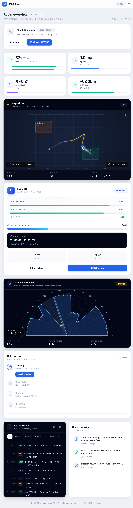
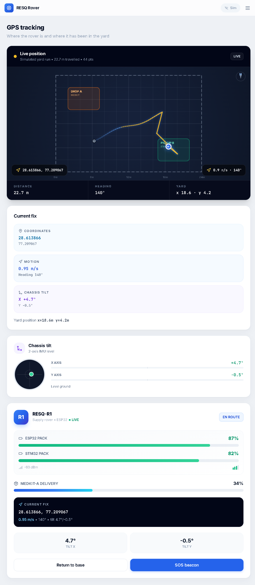
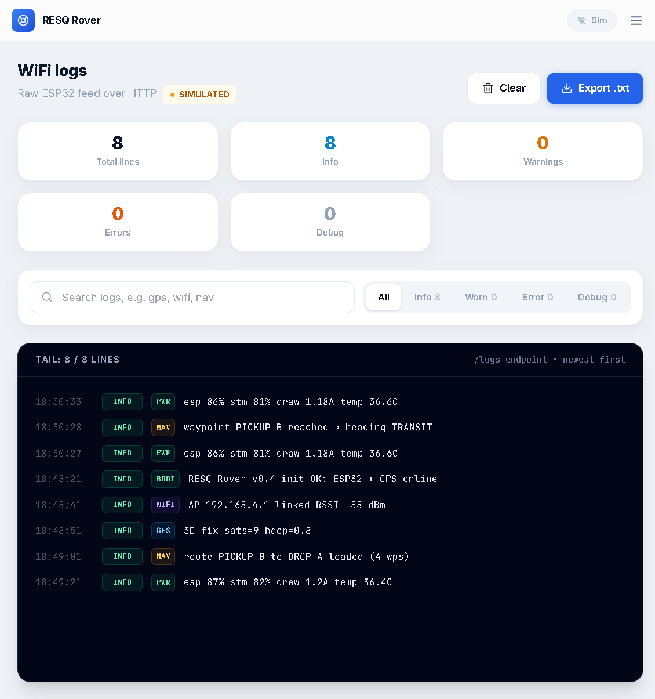

# RESQ-ROVER

**Team NODE-X | BuildFest 2.0 | PS-26**
Guru Nanak Dev University, Department of Mechanical Engineering

A low-cost 4-wheel rover that carries a first-aid kit across rubble to a drop zone. It drives itself between waypoints, steers around obstacles with a 180-degree radar, cuts motors the moment it tips, and unlocks the kit only on arrival.

Live dashboard: https://resq-rover.vercel.app

## Screenshots

| Overview | Tracking | WiFi logs |
|---|---|---|
|  |  |  |

## Where things live

* `/CAD` - OpenSCAD parametric model plus ready-to-print STLs for the chassis plates.
* `/firmware` - C++ for both boards: STM32 handles motors and the tilt cut-off, ESP32 handles radar, GPS and the WiFi log feed. Flashing steps are in [firmware/README.md](firmware/README.md).
* `/dashboard` - React + TypeScript web UI for monitoring. Runs against the ESP32 over WiFi, falls back to a simulator when no hardware is linked. Setup is in [dashboard/README.md](dashboard/README.md).
* `/Docs` - BuildFest presentation PDF and the screenshots above.

## How it works

1. Mission starts: drive to the next waypoint.
2. Radar scans 180 degrees every sweep and picks the widest gap.
3. Tilt past 25 degrees kills the motors instantly. Stuck detection triggers auto-recovery.
4. At the drop zone the kit latch opens and the run gets logged.

The mission keeps running onboard even if the WiFi link drops. The dashboard is for watching, not for driving.

## Team

Bhawan (Team Lead), Ananaya, Lakshay, Jaskaran.

---
Built by Team NODE-X at Guru Nanak Dev University.
